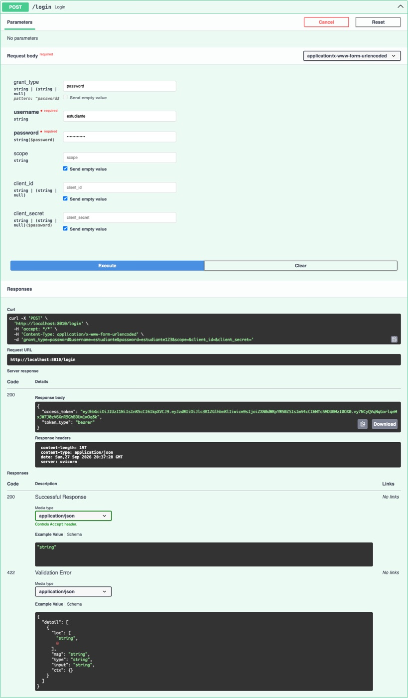
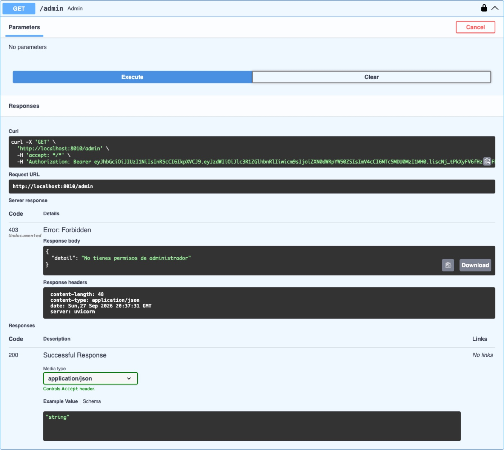
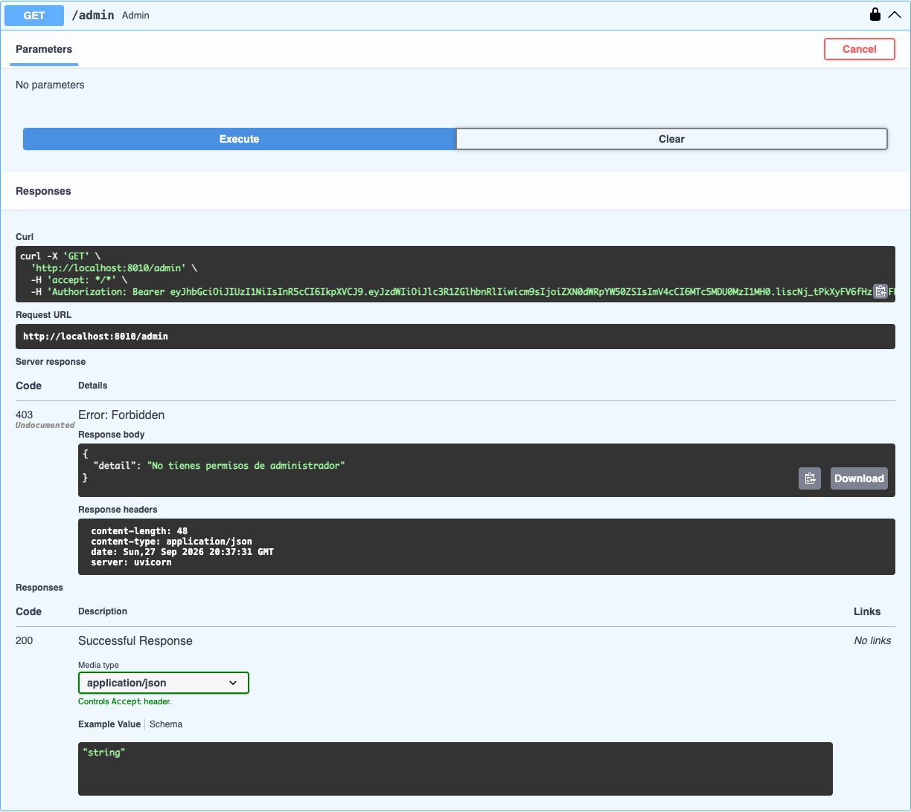

# Unidad IV · Semana 10 — Autenticación con JWT en FastAPI

<!-- teaser:start -->
<p align="center">
  
</p>

<!-- teaser:end -->


API con FastAPI que implementa login con JWT, endpoints públicos, privados y con control de rol.

## Cómo ejecutar

```bash
pip install -r requirements.txt
uvicorn main:app --reload
```

Abrir http://127.0.0.1:8000/docs

Usuarios de prueba:

| Usuario      | Contraseña      | Rol        |
|--------------|-----------------|------------|
| `admin`      | `admin123`      | admin      |
| `estudiante` | `estudiante123` | estudiante |

---

## PARTE A — Conceptual

### P1. ¿Qué significa JWT y cuáles son sus tres partes?

JWT significa **JSON Web Token**. Es un estándar (RFC 7519) para transmitir información entre cliente y servidor en forma de token compacto y **firmado**, de modo que el servidor puede comprobar que no fue alterado. Se usa para autenticación sin estado: después del login, el cliente envía el token en cada petición en el header `Authorization: Bearer <token>`.

Tiene tres partes separadas por puntos (`xxxxx.yyyyy.zzzzz`), cada una codificada en Base64URL:

1. **Header**: tipo de token y algoritmo de firma, por ejemplo `{"alg": "HS256", "typ": "JWT"}`.
2. **Payload**: los *claims* o datos, por ejemplo `sub` (usuario), `rol` y `exp` (expiración).
3. **Signature**: la firma, calculada como `HMACSHA256(base64(header) + "." + base64(payload), SECRET_KEY)`. Garantiza la integridad del token.

### P2. ¿Por qué el payload NO es seguro para guardar contraseñas?

Porque el payload solo está **codificado en Base64URL, no cifrado**. Cualquier persona que obtenga el token puede decodificarlo y leer su contenido sin conocer la `SECRET_KEY` (por ejemplo en jwt.io). La firma protege contra **modificaciones**, pero no oculta la información. Además, el token viaja en cada petición y puede quedar guardado en el navegador o en logs. Por eso en el payload solo se ponen datos no sensibles (en este proyecto `sub` y `rol`), y las contraseñas se guardan en el servidor **hasheadas con bcrypt**.

### P3. ¿Qué sucede si alguien modifica el payload sin conocer el SECRET_KEY?

La firma deja de coincidir. Cuando el servidor recibe el token, vuelve a calcular la firma con el header, el payload recibido y su `SECRET_KEY`, y la compara con la firma del token. Como el atacante cambió el payload (por ejemplo `"rol": "estudiante"` → `"rol": "admin"`) pero no puede generar una firma válida sin la clave, la verificación falla: `jwt.decode()` lanza `JWTError` y la API responde **401 Unauthorized**. Así se evita que alguien se dé permisos que no tiene.

### P4. Diferencia entre 401 Unauthorized y 403 Forbidden. ¿Cuándo usa cada uno FastAPI?

- **401 Unauthorized**: problema de **autenticación**, es decir, el servidor no sabe quién eres. Ocurre cuando no se envía token, el token está mal formado, fue alterado o expiró. En este proyecto lo devuelve `OAuth2PasswordBearer` cuando falta el header `Authorization` (`"Not authenticated"`), `get_current_user` cuando `jwt.decode` falla y `/login` con credenciales incorrectas. Va acompañado del header `WWW-Authenticate: Bearer`.
- **403 Forbidden**: problema de **autorización**. El servidor sí sabe quién eres (el token es válido), pero no tienes permiso para ese recurso. En este proyecto lo devuelve `/admin` cuando el usuario autenticado tiene rol `estudiante`.

Dicho de forma corta: 401 significa "identifícate" y 403 significa "ya sé quién eres, pero no puedes entrar".

---

## PARTE B — Práctica

### `auth.py`

- `hash_password(password)`: genera el hash con bcrypt (`passlib`).
- `verify_password(plain, hashed)`: verifica la contraseña contra el hash.
- `create_token(data)`: crea el JWT con `python-jose`, algoritmo HS256 y expiración (`exp`) de 30 minutos.
- `get_current_user(token)`: dependencia que decodifica y valida el token; si es inválido devuelve 401.

### `main.py`

| Método | Ruta       | Protección                                         |
|--------|------------|----------------------------------------------------|
| POST   | `/login`   | Pública. Devuelve `access_token`                   |
| GET    | `/publico` | Pública                                            |
| GET    | `/privado` | `Depends(get_current_user)`: requiere token        |
| GET    | `/admin`   | `Depends(get_current_user)` + rol `admin`, si no 403 |

### Capturas Swagger

**1. POST /login → 200 con token**


**2. GET /privado → 200 (autenticado como estudiante)**


**3. GET /admin → 403 (rol estudiante)**


